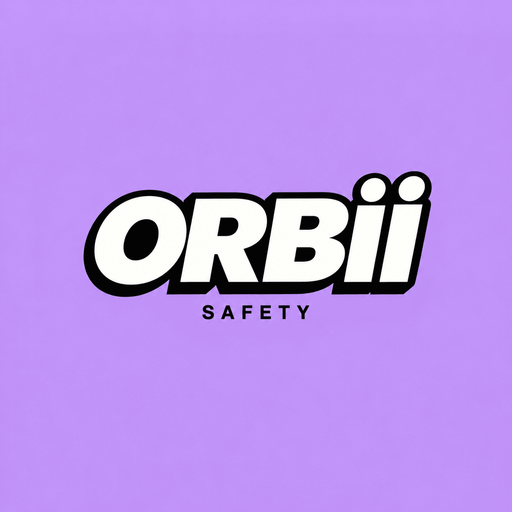

# ORBII

### Help should arrive before panic does.

**Safety for India's workforce and for everyone in it.**
ORBII Teams keeps employees, field staff and students safe at work and on the move.
The ORBII app gives anyone a hands-free SOS that works on a locked phone, even with no internet.

[Website](https://www.orbii.in) ·
[ORBII Teams](https://www.orbii.in/orbii-teams) ·
[Get it on Google Play](https://play.google.com/store/apps/details?id=in.orbii.app) ·
[Trust and data](https://www.orbii.in/trust) ·
[Privacy policy](https://www.orbii.in/privacy-policy)

> This is the public showcase of ORBII, built by ORBII Private Limited in India.
> The source code is proprietary and lives in a private repository.

---

## The problem

When someone is in danger they usually cannot unlock a phone, find an app and type. A technician alone at a site, a sales visit in a new area, a late cab home: the alert has to work hands-free, on a bad network, and it has to reach a person who acts on it. Most safety tools assume a free hand, a signal and someone watching a screen.

## ORBII Teams: for companies and campuses

Everyone on the plan gets the ORBII app. HR and the Safety Desk get a live web console.

| | What it does |
|---|---|
| **SOS that works anywhere** | Voice, button, fall or shake. Recognised on the phone, so it works with the screen locked and no internet, and falls back to SMS. |
| **Work trips** | A destination and a back-by time. Late? The person is asked first, then the Safety Desk is alerted. |
| **Site check-in** | Automatic check-in and check-out at company sites during a trip. |
| **Escalation ladder** | If nobody takes an alert: the reporting manager, then the HOD, then the desk, each after a set time. |
| **Proof every alert reached a person** | Each alert is timed from the moment it fires to the first person who opened or took it, with a report a company can share. |
| **Prevention before the trip** | A risk check on every trip (night travel, long drives, official warnings, severe weather), an optional safety checklist, and manager approval for high-risk trips. Safety never waits on a manager: an employee can always go, with a reason. |
| **Official warnings** | Indian disaster and weather warnings matched to the people and sites inside them, and "Are you safe?" sent only to those people. |
| **Problem reports** | Report a hazard with a photo or a voice note, even with no signal. It gets an owner and a date, and the reporter is told when it is fixed. |
| **A score per site, never per person** | Each location gets a safety score with what lowered it and what to do. |
| **Night-commute record** | Night-work consent, the cab and driver, and a guard in the cab, kept per commute. |
| **A change log nobody can edit** | Every action is recorded with a fingerprint chain, so any change to the history shows. |

**What the company never sees:** location outside a trip or an SOS, health information, personal circles or messages. ORBII enforces this on the server, and every person can see who looked at their location.

## The ORBII app: for everyone

- **Hands-free Voice SOS** in English and Hindi. Say it twice and ORBII raises the alarm, even with the phone locked. Audio never leaves the phone.
- **Fall detection** with a countdown to cancel.
- **Your circle**: family who get your SOS with your live location.
- **Safe Journey, Safe Routes and Audio Escort** for the walk home.
- **Medical priority**: a serious condition makes the SOS faster and tells helpers what they need to know.
- **When the network fails**: SMS fallback and a Bluetooth relay between phones (in field testing).

## How it is built

- **On the phone:** React Native (Expo) and TypeScript, with native Kotlin services for voice and motion on Android, and Swift on iPhone (in development).
- **On the server:** Postgres with row-level security, realtime channels, serverless functions and scheduled jobs.
- **The console and website:** Astro.
- **Maps:** MapLibre with open vector tiles.

Design rules we keep:

- **Alert people first, save the record second.** A slow network never delays help.
- **Score places, routes and times, never people.** Nothing ORBII collects is used for performance or discipline.
- **Every change is tested, then attacked** with rolled-back security checks before it ships.

## Status

- **Live:** the ORBII app on Google Play (Android), and ORBII Teams with its web console at [orbii.in/teams](https://www.orbii.in/teams).
- **In field testing:** the Bluetooth relay and the verified-responder network.
- **In development:** the iPhone app.

We say plainly what is proven and what is still in testing. Speed and battery figures in our materials are from our own testing, not an independent audit.

## Contact

Companies and universities: [orbii.in/orbii-teams](https://www.orbii.in/orbii-teams) · orbiisafety@gmail.com
